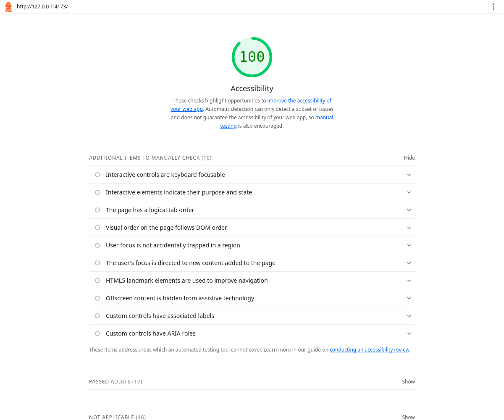
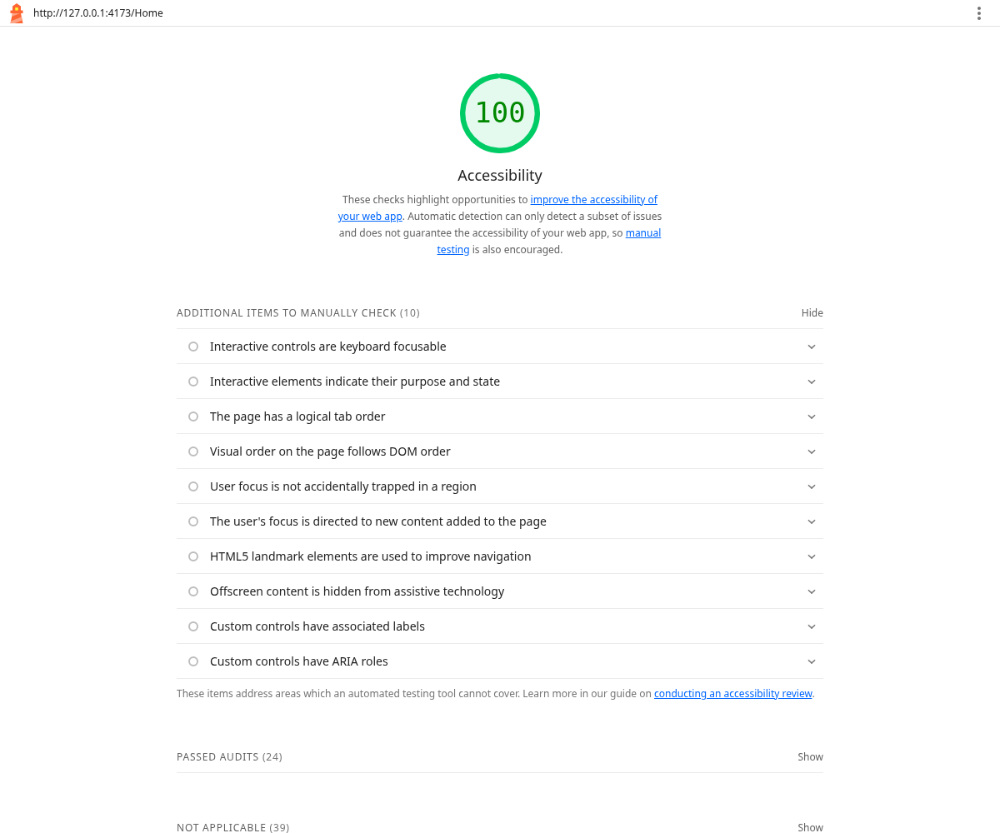
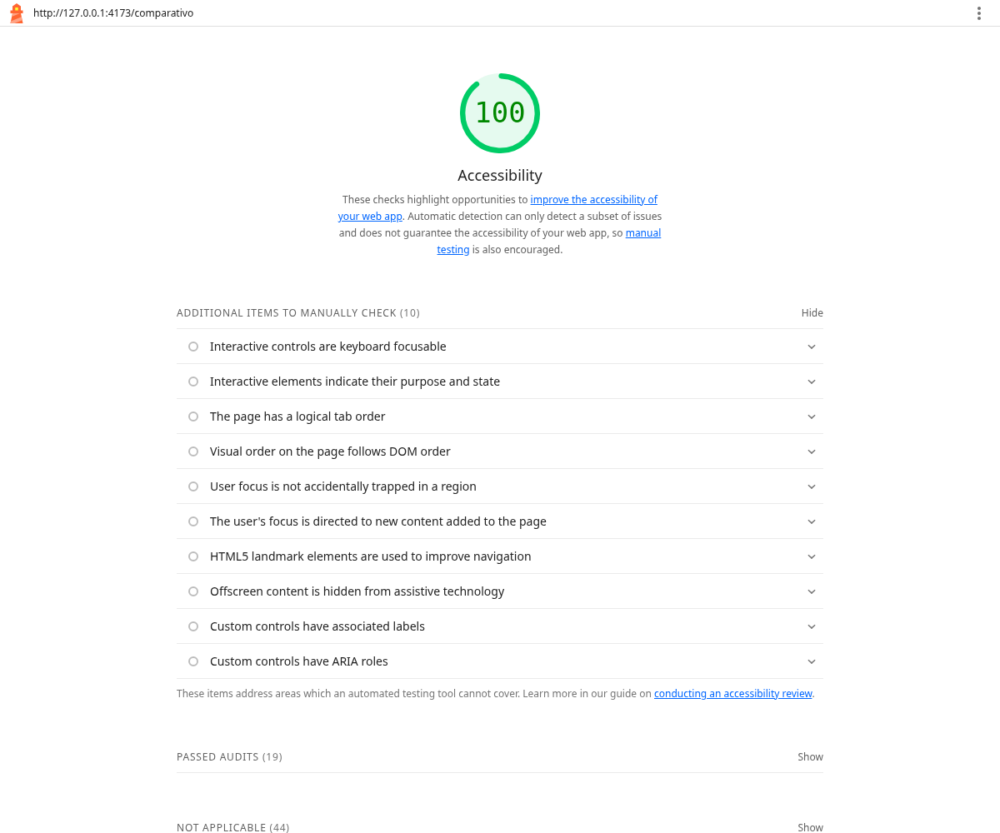

# Resultados de QA — 19/10/2026

## Resultado observado

- **Build e ESLint:** aprovados; aviso de tamanho do bundle registrado, sem falha de compilação.
- **Responsividade:** 36 cenários (9 páginas × 320, 375, 768 e 1440 px), sem rolagem horizontal da página e sem campos visíveis sem label associado.
- **Interações:** 9 grupos de verificações aprovados: erros associados, dicas por foco/clique/Escape, resultados e email em 320 px, rolagem local da tabela por teclado, FAQ, link de salto, Tab e Shift+Tab.
- **axe-core:** 7 estados adicionais com zero violações nos grupos WCAG 2 A/AA e WCAG 2.1 AA verificados. Os itens inconclusivos permanecem para avaliação manual.
- **Escopo:** backend, rotas globais e funções de cálculo/Fator R/PDF preservados na comparação com o ZIP.

## Lighthouse — somente acessibilidade

Execução em Chromium headless, com emulação mobile padrão do Lighthouse 13.5.0. A pontuação de cada página abaixo se refere ao estado inicial; o histórico mostra falha de conexão com backend. Um token fictício permite abrir as páginas que verificam sua presença no navegador. O Lighthouse não autentica esse token no servidor. Os resultados e o histórico preenchido foram avaliados separadamente com axe e respostas simuladas.

| Página auditada | Acessibilidade | Evidências originais |
| --- | --- | --- |
| `/` | 100/100 | [HTML](evidencias/lighthouse-landing.html) · [JSON](evidencias/lighthouse-landing.json) · [captura](evidencias/lighthouse-landing.png) |
| `/login` | 100/100 | [HTML](evidencias/lighthouse-login.html) · [JSON](evidencias/lighthouse-login.json) · [captura](evidencias/lighthouse-login.png) |
| `/cadastro` | 100/100 | [HTML](evidencias/lighthouse-cadastro.html) · [JSON](evidencias/lighthouse-cadastro.json) · [captura](evidencias/lighthouse-cadastro.png) |
| `/RecuperarSenha` | 100/100 | [HTML](evidencias/lighthouse-RecuperarSenha.html) · [JSON](evidencias/lighthouse-RecuperarSenha.json) · [captura](evidencias/lighthouse-RecuperarSenha.png) |
| `/Home` | 100/100 | [HTML](evidencias/lighthouse-Home.html) · [JSON](evidencias/lighthouse-Home.json) · [captura](evidencias/lighthouse-Home.png) |
| `/calculo-pf` | 100/100 | [HTML](evidencias/lighthouse-calculo-pf.html) · [JSON](evidencias/lighthouse-calculo-pf.json) · [captura](evidencias/lighthouse-calculo-pf.png) |
| `/calculo-pj` | 100/100 | [HTML](evidencias/lighthouse-calculo-pj.html) · [JSON](evidencias/lighthouse-calculo-pj.json) · [captura](evidencias/lighthouse-calculo-pj.png) |
| `/comparativo` | 100/100 | [HTML](evidencias/lighthouse-comparativo.html) · [JSON](evidencias/lighthouse-comparativo.json) · [captura](evidencias/lighthouse-comparativo.png) |
| `/historico` | 100/100 | [HTML](evidencias/lighthouse-historico.html) · [JSON](evidencias/lighthouse-historico.json) · [captura](evidencias/lighthouse-historico.png) |

**Meta de 90 pontos atendida nas nove URLs auditadas.** Não foram estabelecidas metas para desempenho, boas práticas ou SEO. Não há auditoria anterior completa que permita quantificar uma evolução de pontuação.

Figura 1 — Captura do relatório Lighthouse da página inicial.

Figura 2 — Captura do relatório Lighthouse do painel.

Figura 3 — Captura do relatório Lighthouse do comparativo no estado inicial.

## Contraste

Os cálculos da paleta estão em [contraste-paleta.json](evidencias/contraste-paleta.json): `#595959` sobre branco = 7,00:1; sobre `#EFEFEF` = 6,09:1; branco sobre `#CD371F` = 5,05:1; verde `#15803d` sobre branco = 5,02:1; destaque `#ffad9e` sobre `#132436` = 8,79:1. Os cartões dos resultados mantêm opacidade total para preservar contraste.

## Limites e pendências

Resultados com fixtures demonstram comportamento de interface; não comprovam precisão tributária, API, JWT, banco, envio de email ou PDF. As evidências `resultado-fixture-*` e `historico-fixture-*` contêm dados arbitrários. Não foram executados testes com leitores de tela, dispositivos físicos ou integração real. Lighthouse/axe não certificam conformidade integral com WCAG.

Completar a identificação acadêmica e confirmar as atividades dos quatro integrantes. Encaminhar os destinos ausentes de FAQ/Sobre ao Membro 2 e homologar cálculos com o Membro 1 e exportação com o Membro 3. Consulte o [plano de testes](PLANO_DE_TESTES.md).

## Arquivos de verificação

- [Matriz de responsividade](evidencias/responsividade.json)
- [Testes interativos](evidencias/estados-interativos.json)
- [Auditoria dos estados adicionais](evidencias/axe-estados.json)
- [Build e ESLint](evidencias/verificacao-build-lint.txt)
- [Preservação de escopo](evidencias/escopo-alteracoes.json)
- [Como reproduzir](qa/README.md)
